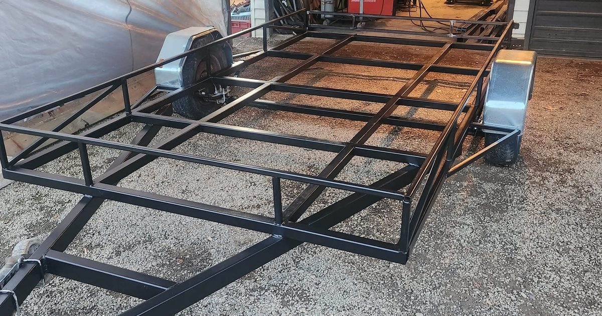

<p align="center">
  <a href="https://splitpin-engineering.vercel.app"></a>
</p>

<h1 align="center">Split Pin Engineering Website</h1>

<p align="center">
  Static, mobile-first site for Split Pin Engineering, a welding and fabrication business run by Jason Wilson as a sole trader in Palmerston North.<br>
  Designed, built and maintained by <a href="https://savepoint.co.nz"><b>Save Point Limited</b></a>, New Zealand.
</p>

<p align="center">
  <a href="https://splitpin-engineering.vercel.app">Live site</a> ·
  <a href="docs/README.md">Docs</a> ·
  <a href="docs/owner-guide.md">Owner Guide</a> ·
  <a href="docs/developer-guide.md">Developer Guide</a> ·
  <a href="SECURITY.md">Security</a> ·
  <a href="LICENSE">Licence</a>
</p>

---

> [!IMPORTANT]
> This is client work, not a template. The code is public so Split Pin Engineering and Save Point can both see it. It is **not** open source. The site code belongs to Save Point Limited, and the Split Pin Engineering name, logo, photos and written content belong to Split Pin Engineering. Neither may be copied or reused. See [LICENSE](LICENSE).

No build step, no dependencies. Plain HTML, CSS and JS, hosted on Vercel.

Full documentation is in [`docs/`](docs/README.md): an owner guide for Jason, a developer
guide, and notes on the legal page.

## Project layout

```
splitpin-engineering/
├── index.html            # Home: hero, services overview, recent work, about teaser
├── services.html         # Each service in detail + how it works      (/services)
├── about.html            # About the business                         (/about)
├── work.html             # Filterable photo gallery with lightbox     (/work, /work?cat=gates)
├── contact.html          # Contact details + quote form               (/contact)
├── legal.html            # Privacy, terms of trade, warranty, cookies, website terms (/legal)
├── 404.html              # Not-found page
├── css/styles.css        # All styles (mobile-first)
├── js/
│   ├── gallery-data.js   # Gallery photo list (edit this to add/remove photos)
│   └── main.js           # Nav, gallery filters, lightbox, quote form
├── images/
│   ├── hero.webp  og.jpg
│   └── work/             # Optimised photos (full = lightbox, thumb = grid)
├── tools/optimise-images.py  # Helper to optimise new photos
├── docs/                 # Owner guide, developer guide, legal notes
├── favicon.svg
├── robots.txt  sitemap.xml  llms.txt
├── vercel.json           # Clean URLs, caching and security headers
├── LICENSE               # All rights reserved (Save Point code, Split Pin content)
└── SECURITY.md
```

Original full-resolution photos (`/*.jpg` in the repo root) are git-ignored; only the optimised copies in `images/work/` are committed.

The header and footer are repeated in each HTML page, so nav or footer changes need making in all six.

## Before going live: replace placeholders

Phone (022 016 7223) and email (splitpin176v@gmail.com) are set. Still to confirm:

- **Hours**: contact.html
- **Domain**: the site currently uses `https://splitpin-engineering.vercel.app` as its
  address in canonical/OG tags, JSON-LD, robots.txt, sitemap.xml and llms.txt. If a custom
  domain is added, find-and-replace that URL everywhere.
- Have the legal page reviewed. It's a sensible NZ starting point, not legal advice.
  See [docs/legal-notes.md](docs/legal-notes.md) for what to check.

## SEO

- Every page has a location-focused title and description (Palmerston North / Manawatū),
  a canonical URL, Open Graph tags and `HomeAndConstructionBusiness` JSON-LD (plus breadcrumbs
  on inner pages). Keep these in step if contact details or services change.
- `robots.txt` allows all crawlers and names the main AI search bots explicitly.
- `llms.txt` is a plain-text summary of the business for AI assistants.
- Update `<lastmod>` in `sitemap.xml` when pages change.

## Branding

The logo and the sign replica on the contact page are built in HTML/CSS from a photo of the
workshop sign (no original artwork file). Fonts: Russo One (SPLIT PIN, skewed), Michroma
(ENGINEERING plate and phone number). Classes: `.logo`, `.sign`, `.dot-list`.

## Run locally

```sh
npx serve .        # or: python3 -m http.server
```

## Deploy to Vercel

1. Push this repo to GitHub.
2. In Vercel: **Add New → Project → Import** the repo.
3. Framework preset: **Other**. Leave build command and output directory empty.
4. Deploy, then add the custom domain under **Settings → Domains**.

Or from the CLI: `npx vercel` (preview) and `npx vercel --prod`.

## Adding photos

```sh
pip install pillow
python tools/optimise-images.py ~/Pictures/new-gate.jpg
```

Paste the printed line into `js/gallery-data.js`, set the category
(`gates`, `handrails`, `trailers`, `vehicle`, `farm`, `fabrication`) and a caption.

## Quote form

The form opens the visitor's email app with their details pre-filled (no backend needed).
To receive submissions directly instead, point the form at a service like Formspree or
Web3Forms and replace the submit handler in `js/main.js`.

## Cache busting

Each page loads CSS/JS with a version tag (e.g. `/css/styles.css?v=df132369`) so visitors
never get stuck on an old stylesheet. After editing `css/styles.css` or anything in `js/`,
change the `?v=` value in every HTML page (any new value works; a short hash of the file is tidy).

## Ownership

The site code (HTML structure, CSS, JavaScript and tools) is © 2026 Save Point Limited, a New Zealand company (company number 9392145). The Split Pin Engineering name, workshop-sign logo, photos and written content are © Split Pin Engineering. All rights reserved.

- Save Point: [savepoint.co.nz](https://savepoint.co.nz) · [contact@savepoint.co.nz](mailto:contact@savepoint.co.nz) · support [support@savepoint.co.nz](mailto:support@savepoint.co.nz)
- Split Pin Engineering: 022 016 7223 · [splitpin176v@gmail.com](mailto:splitpin176v@gmail.com)

"Save Point" and the Save Point flag logo are the property of Save Point Limited. Russo One and Michroma are Google Fonts under the SIL Open Font License. Vercel is a trademark of its owner.
